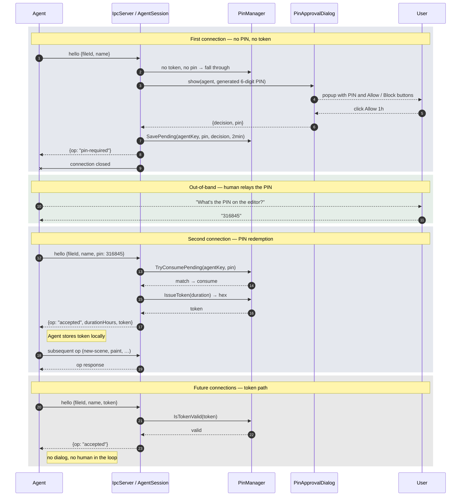

# 002 Agent Connecting

AS a human operator of the editor
I WANT to grant trusted agents access to drive the editor
SO THAT I can automate tasks without opening the editor up to anyone who finds the port

GIVEN the editor is running
WHEN an agent connects without supplying a PIN or token
THEN a dialog pops up on my screen showing a freshly generated 6-digit PIN
AND the dialog shows the agent's name and source address
AND the dialog offers Allow 1 hour, Allow 24 hours, and Block

GIVEN a connection dialog is open
WHEN I click Block
THEN the agent's connection is rejected
AND no pending authorisation is saved

GIVEN a connection dialog is open
WHEN I click Allow 1 hour or Allow 24 hours
THEN the server stores the PIN as a pending authorisation for two minutes
AND the server replies to the agent with pin-required
AND the agent's current connection closes

GIVEN the server holds a pending authorisation for an agent
WHEN the agent reconnects supplying the matching PIN
THEN the server replies accepted along with a persistent hexadecimal token
AND the token is valid for the duration I originally chose

GIVEN an agent holds a valid token from a previous session
WHEN the agent reconnects supplying that token instead of a PIN
THEN no dialog appears on my screen
AND the server accepts the connection immediately

GIVEN there is no pending authorisation for an agent
WHEN that agent sends a hello carrying a PIN
THEN the server replies with an error
AND no token is issued

GIVEN a token is expired or unknown
WHEN the server receives a hello carrying that token
THEN the server treats the hello as if no token were supplied
AND a new PIN dialog pops up on my screen

GIVEN a pending authorisation is older than two minutes
WHEN an agent reconnects supplying the matching PIN
THEN the server rejects it as expired
AND the agent must restart the connection flow from the beginning

## Process chain

